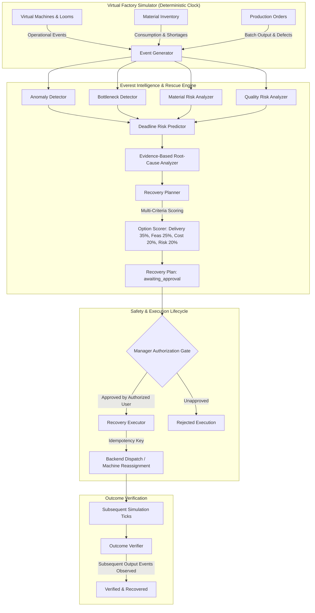

# Everest Textile OS — Intelligence & Virtual Factory Architecture Design

**Member 3:** Virtual Factory Simulator & The Everest Rescue Engine  
**Target Platform:** Everest Textile Mills Intelligent Operations Platform  
**Branch:** `feature/member-3-intelligence`  

---

## 1. Executive Summary

In a modern textile manufacturing facility (Everest Textile Mills), disruptions such as unexpected loom stoppages, yarn shortages, and dyeing defect drift are inevitable. Physical sensors and hardware IoT links are often unavailable or siloed during development.

Member 3 implements two tightly integrated sub-systems:
1. **Virtual Factory Simulator**: A deterministic, step-based simulation of textile machinery (spinning, weaving, dyeing, inspection, roll creation) producing realistic operational telemetry explicitly tagged with `"source": "simulator"`.
2. **Everest Rescue Engine (Intelligence & Recovery Engine)**: A transparent, evidence-based decision intelligence engine that detects anomalies, predicts order deadline risks, diagnoses root causes, generates feasible recovery plans, enforces manager authorization, and verifies post-action recovery.



---

## 2. Safety Lifecycle State Machine

To prevent AI from arbitrarily modifying physical or ERP manufacturing records without human oversight, the system strictly enforces the following lifecycle:

```
[ DETECTED ] ──> [ ANALYZED ] ──> [ PROPOSED ] ──> [ AWAITING_APPROVAL ]
                                                              │
                                      ┌───────────────────────┴───────────────────────┐
                                      ▼                                               ▼
                                 [ APPROVED ]                                    [ REJECTED ]
                                      │
                                      ▼
                                [ EXECUTING ]
                                      │
                                      ▼
                                 [ EXECUTED ]
                                      │
                  ┌───────────────────┴───────────────────┐
                  ▼                                       ▼
            [ VERIFIED ]                         [ VERIFICATION_FAILED ]
```

### Safety Constraints:
* **No Auto-Execution**: An action is never dispatched simply because the model scored it highest.
* **Idempotency Protection**: Execution requests require an `idempotency_key` (SHA-256 fingerprint). Repeated execution calls return idempotent cached responses and will not trigger duplicate production reassignment.
* **Non-Fabricated Verification**: A plan is **never** marked `verified` upon approval. It is only marked `verified` if subsequent simulation events prove that production resumed and output advanced.

---

## 3. Data Contracts & REST API Proposal (Integration with Member 2)

The engine interacts with Member 2's FastAPI backend through the `BackendAdapter` pattern (`intelligence/data_access.py`), supporting both local in-memory execution and HTTP REST communication.

### Base URL Configuration
Configured via environment variable:
```bash
export EVEREST_API_BASE_URL="http://localhost:8000"
```

### Proposed Backend Endpoints

#### 1. Machine Fleet
* **`GET /api/v1/machines`**
  * **Response**: List of machine objects (`machine_id`, `name`, `process_type`, `state`, `assigned_order_id`, `rate_per_hour`, `efficiency`, `source`).

#### 2. Production Orders
* **`GET /api/v1/production/orders`**
  * **Response**: List of active work orders (`order_id`, `customer_name`, `fabric_type`, `ordered_quantity`, `produced_quantity`, `deadline`, `status`).

#### 3. Simulation Events
* **`POST /api/v1/production/events`**
  * **Body**:
    ```json
    {
      "event_id": "SIM-EVT-00003",
      "event_type": "machine_breakdown",
      "machine_id": "M-LOOM-01",
      "production_order_id": "PO-NORM-101",
      "timestamp": "2026-10-10T08:30:00Z",
      "source": "simulator",
      "details": {
        "reason": "main_drive_motor_bearing_failure",
        "severity": "critical"
      },
      "idempotency_key": "9a5b3f124c89"
    }
    ```

#### 4. Alerts
* **`POST /api/v1/alerts`**
  * **Body**:
    ```json
    {
      "alert_type": "active_order_on_broken_machine",
      "entity_id": "M-LOOM-01",
      "severity": "critical",
      "title": "Air-Jet Loom 1 Breakdown",
      "description": "Production stalled on Order PO-NORM-101"
    }
    ```
  * **Response**: `{"alert_id": "ALT-0001"}`

#### 5. Recovery Plans
* **`POST /api/v1/recovery-plans`**
  * **Body**: Serialized `RecoveryPlan` payload with candidate options.
* **`GET /api/v1/recovery-plans/{plan_id}`**
  * **Response**: Full `RecoveryPlan` model.
* **`POST /api/v1/recovery-plans/{plan_id}/approve`**
  * **Body**: `{"manager_id": "MGR-HARSHA-JAGGI"}`
* **`POST /api/v1/recovery-plans/{plan_id}/execute`**
  * **Body**:
    ```json
    {
      "option_id": "OPT-REASSIGN",
      "idempotency_key": "DEMO-RESCUE-IDEM-001"
    }
    ```
* **`PATCH /api/v1/recovery-plans/{plan_id}/verification`**
  * **Body**:
    ```json
    {
      "verification_result": "verified",
      "verification_details": "Observed 95.0 units produced post-execution."
    }
    ```

---

## 4. Frontend Payload Contracts (Integration with Member 1)

Member 1's Rescue Engine UI consumes structured, explainable payloads. Sample fixtures are provided in [fixtures/sample_rescue_plan.json](file:///Users/harshajaggi/odoo%20final%20round/Textile_Manufacturing_System/fixtures/sample_rescue_plan.json) and [fixtures/sample_dashboard_summary.json](file:///Users/harshajaggi/odoo%20final%20round/Textile_Manufacturing_System/fixtures/sample_dashboard_summary.json).

### Transparent Multi-Criteria Scoring Formula

For each option $i$:
$$\text{Score}_i = w_{\text{delivery}} \cdot S_{\text{delivery}} + w_{\text{feasibility}} \cdot S_{\text{feasibility}} + w_{\text{cost}} \cdot S_{\text{cost}} + w_{\text{risk}} \cdot S_{\text{risk}}$$

Where default configurable weights are:
* $w_{\text{delivery}} = 0.35$ (Delay reduction impact)
* $w_{\text{feasibility}} = 0.25$ (Machine compatibility & operational availability)
* $w_{\text{cost}} = 0.20$ (Additional monetary expenditure minimization)
* $w_{\text{risk}} = 0.20$ (Quality & safety hazard avoidance)

If an option is **infeasible** (e.g. no idle loom of matching type exists), its score is strictly $0.0$ and its `feasible` property is `false` with an explicit `infeasibility_reason`.

---

## 5. Pre-Built Repeatable Scenarios

Selectable via `simulator.load_scenario(name, random_seed)`:

1. **Scenario A — Normal Production**: Standard 24h run on Air-Jet Loom 1 with healthy machines and yarn stock.
2. **Scenario B — Machine Breakdown**: Sudden drive motor failure on active loom halting high-priority order. Triggers the primary Rescue Engine workflow.
3. **Scenario C — Raw Material Shortage**: High-priority poplin shirting order starved of combed cotton warp yarn with depleted stock.
4. **Scenario D — Quality Deterioration**: Loom tension drift leading to defect spikes and quarantined fabric rolls (prevented from dispatch).
5. **Scenario E — Urgent Customer Order**: Rush 300m order with a 5-hour deadline evaluated for line balancing and overtime feasibility.

---

## 6. How to Run & Validate

### 1. Execute Unit & Safety Tests
```bash
python3 -m pytest -v
```
*(All 19 automated tests run in <0.1s verifying determinism, non-negative bounds, safety gates, and outcome verification).*

### 2. Run the Full Closed-Loop Demonstration
```bash
python3 demo_rescue_flow.py
```
*(Runs the entire 10-step story from healthy simulation to breakdown, diagnosis, plan generation, manager approval, action execution, and subsequent verification).*
